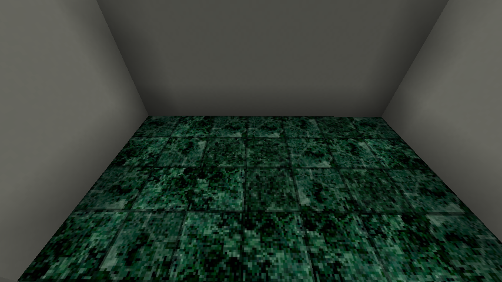
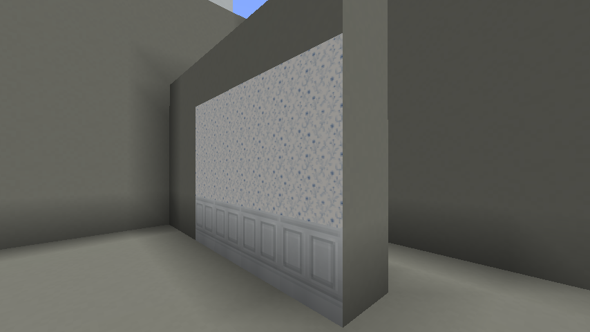
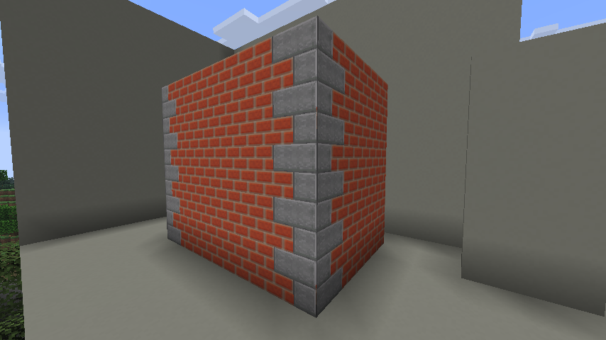
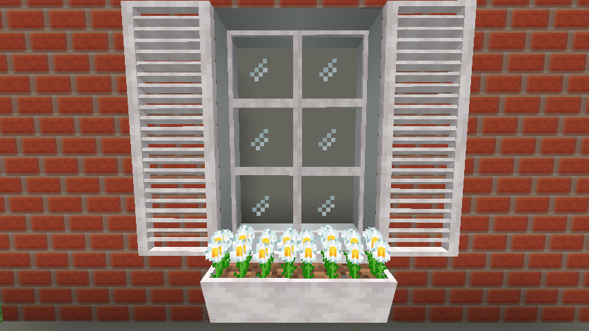
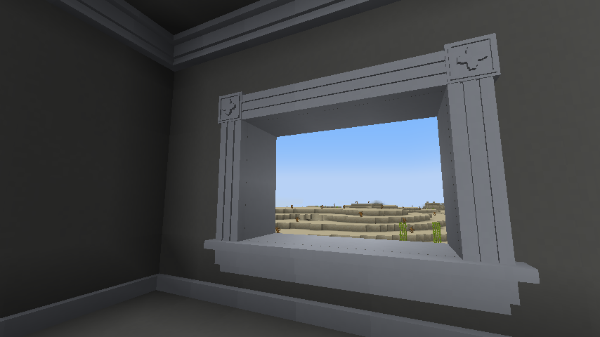
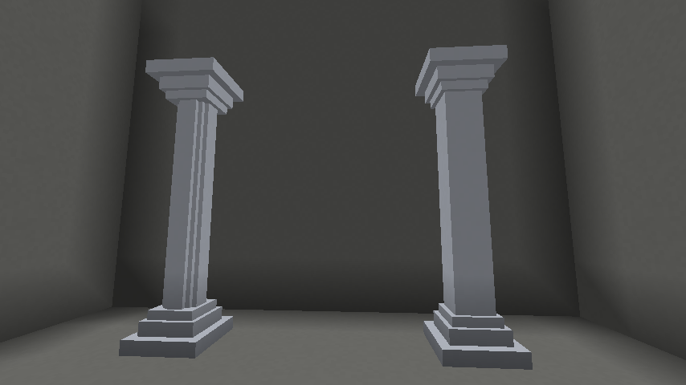
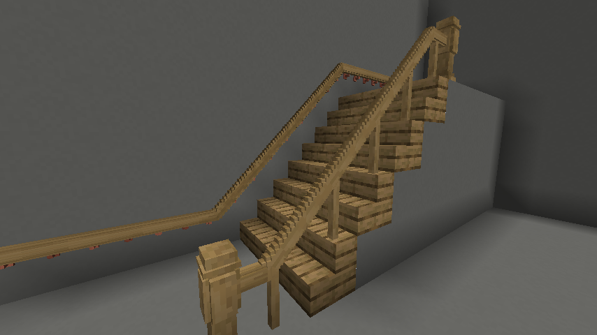

# Building and architectural details

[Manual contents](README.md) · [Recipes](recipes.md) · [Catalog](catalog.md)

Use structural blocks for floors and walls, face-applied finishes for their appearance, and separate trim blocks for depth. Finishes do not replace the underlying block; trim occupies an adjacent block space even when its model is thin.

## Materials and flooring

The building palette includes buff bricks and their slabs, stairs, and walls; calcite slabs, calcite tile, marble tile, and octagonal inset tile; parquet wood flooring; and brushed stainless steel. See the catalog for exact variants and the recipe reference for crafting, smelting, and stonecutting routes. Parquet comes in all 13 woods listed in the [reference](reference.md), including poplar. Parquet is a building block, while wallpaper and siding are applied finishes.

### Natural variation in calcite and marble tile

**Calcite Tile** and **Marble Tile** use stochastic placement: each time you place a tile, its texture receives a randomly chosen rotation of 0°, 90°, 180°, or 270°. Marble tile also randomly chooses from several marble textures. These variations give stone veining a more natural appearance across a floor or wall.

The same texture rotation applies to all six faces of a tile; its shape and placement orientation stay unchanged. Each placed tile keeps its appearance when you leave the area or reload the world. Mining it returns the ordinary tile item without preserving the chosen appearance, so placing it again makes a fresh random choice. A fresh choice can still produce the same result.

Tiles already placed before this feature was added retain the original texture with no rotation. Break and replace them if you want to introduce variation into an existing floor.

*Marble tiles mix texture variants and rotations automatically as you place them.*

## Wood-framed window panes

Window panes come in all 13 woods listed in the [reference](reference.md). They use the same clear glass and thin wooden border as [transoms](doors-and-access.md#add-transoms-above-an-entrance), but are only **1 unit deep** and sit at the **center of the block**. Each panel fills one block in width and height. Place matching panes beside and above one another in a window opening: their retained borders give the appearance of wooden muntins between the glass panels. Keep the panes facing along the same axis to form a flat window.

Placement follows the player's facing, or automatically takes the facing of a tall door or sidelight directly below. Panes can be placed elsewhere and remain without supporting blocks. They share the transom's special merge rule: matching panes directly over paired tall doors merge only across that pair. Ordinary window grids retain their frames.

Craft **4 window panes** with a horizontal `SGS` row: `S` is the matching wood slab and `G` is a **glass block**. Transoms use planks around a glass block instead. Obtaining the matching slab unlocks the recipe. Breaking a framed window pane drops one matching item. See the [oak recipe](recipes.md#oak-window-pane) or the catalog for other woods.

## Exterior window ledges

**Brick Window Ledge** and **Buff Brick Window Ledge** finish the exterior below a window. Each ledge occupies its own block space at the top, measuring 16 units wide, 4 units high, and 4 units deep. Place adjacent ledges against the same wall face to form a continuous run with matching brick and mortar detail.

Use a ledge on any vertical block face, including stone, wood, or glass; the supporting wall does not need to be brick. The ledge faces outward from the clicked face and stays at the top of its block space regardless of click height. Floor and ceiling faces do not accept placement. Sneak-place against blocks that normally open an interface.

Craft **16 ledges** from **two matching brick blocks** in a single horizontal `BB` row: use **Bricks** (`minecraft:bricks`) for the [regular brick ledge](recipes.md#brick-window-ledge), or **Buff Bricks** (`atouchofclass:buff_bricks`) for the [buff brick ledge](recipes.md#buff-brick-window-ledge). Obtaining the matching brick block unlocks its recipe. Mixed brick types do not substitute. Mine ledges with a pickaxe to recover them.

## Apply plaster and wall finishes

Use a finish item on the face you want to cover. Each face stores one finish: applying another replaces its appearance rather than adding another layer. Different faces of the same block can carry different finishes.

| Finish | Allowed faces | Use behavior |
| --- | --- | --- |
| Bucket of plaster | Any face, including top and underside | 32 applications in Survival; returns an empty bucket after the last use |
| Wallpaper: cornflower, scalloped, ogee lattice, striped, gothic, pink floral, pink geometric, dark blue floral | Four side faces | Reusable item  |
| Wainscoting | Four side faces | Reusable item |
| Shake siding | Four side faces | Reusable item |
| Stone Quoin | Four side faces | Reusable item; clicked half selects the left or right texture |
| White stucco | All six faces | Reusable item |
| Red brick and buff brick finishes | Side faces and top | Reusable item; cannot apply underneath |

Make quicklime powder by smelting calcite. Combine quicklime powder, a water bucket, and sand in a shapeless recipe to make a bucket of plaster. The bucket also participates in crafting recipes; each crafting remainder uses one application and eventually returns an empty bucket. Plaster cannot be enchanted. Reapplying plaster to a face already carrying that plaster does not consume another application.

To decorate a room, apply wainscoting to the lower row of wall faces and wallpaper above it. Plaster is not a prerequisite for wallpaper. For predictable results, start with ordinary full blocks and a clear view of the target face.

<!-- screenshot:building-01:start -->

*Different rows can carry different finishes without replacing the wall blocks.*
<!-- screenshot:building-01:end -->

### Remove or replace a finish

Start mining the decorated face to remove its overlay first. That initial action is intercepted so the supporting block is not broken by the same start action. Non-plaster overlays return their associated items in Survival; Creative removal drops nothing. Plaster overlays drop nothing, whether stripped from a face or removed by breaking the supporting block. Stop mining after stripping the face if you want to keep the wall intact. Breaking a block through an undecorated face also clears its remaining finishes.

Applying a replacement finish directly overwrites the old finish. Remove a non-plaster finish first if you want its item back. Applied plaster cannot be recovered.

## Stone quoins

Use **Stone Quoin** to add stone corner details to brick or stone walls. Apply it to any side face of a block: click the left half for the left texture or the right half for the right texture. Top and underside faces do not accept quoins. The supporting block does not need to be stone or brick.

For a finished corner, apply quoins separately to the two wall faces that meet there, choosing the half nearest the corner on each face. Repeat up the wall. Quoins use the same overlay system as wallpaper and siding: they do not occupy an extra block space, and each face can hold only one finish. Applying a quoin over a brick siding overlay replaces that face's siding; use brick blocks underneath if you want the brickwork to remain visible around the quoin.

Craft **one Stone Quoin** from **two Stone Bricks blocks** placed diagonally in a 2×2 crafting grid, using `S ` on the first row and ` S` on the second. See the [recipe reference](recipes.md#stone-quoin). The item is reusable; strip it from a face using the [finish removal technique](#remove-or-replace-a-finish) to recover a Stone Quoin in Survival.

<!-- screenshot:building-06:start -->

*Apply quoins to each face separately to continue the stone detail around a brick corner.*
<!-- screenshot:building-06:end -->

## Wood shutters

Shutters are available in oak, spruce, birch, poplar, jungle, acacia, dark oak,
mangrove, cherry, pale oak, bamboo, crimson, and warped.
Place a shutter against a wall's side face. It sits flush against that
face; clicking the left or right half selects that hinge as viewed from
outside the wall. Each shutter is one block high. Stack matching shutters
vertically for continuous side rails and end caps only at the exposed ends.
Sneak-use the top or bottom of a shutter to extend its column, or place each
section against the wall. Top/bottom clicks on ordinary blocks are not accepted.

Use any shutter to open or close its entire uninterrupted vertical group.
The group must have the same wood variety, facing, and hinge side. A gap,
different hinge, or different facing ends the group. Breaking one shutter
leaves the others intact and restores their exposed end caps. Survival
breaking drops one shutter; Creative breaking drops none.

Craft eight shutters from four matching planks and two sticks, with
`WSW` in two crafting rows. Obtaining those planks unlocks that wood's recipe.
Every model face uses the matching stripped wood grain, including the narrow
edges (stripped bamboo block for bamboo, stripped hyphae for crimson and warped).

## Wood window boxes

Window boxes come in all 13 vanilla wood varieties, including poplar. Every
panel uses matching stripped wood with horizontal grain. Bamboo uses stripped
bamboo block; crimson and warped use stripped stem side grain on every face.

Place a box against any horizontal-facing block side. Its back sits flush
against that face. The box occupies the upper eight units of its block space,
projects ten units from the wall, and contains dirt two units below its rim.
The front and exposed ends taper inward by one unit toward the bottom.
Floor and ceiling clicks do not place window boxes. Sneak-place against
blocks that normally open an interface.

Matching boxes with the same facing merge into one continuous horizontal
trough. Click an end to extend it, or place each section against the wall.
Different woods and different facings stay separate. Breaking a section
leaves the others intact and restores their exposed end panels. Each section
drops one matching window box, including its dirt. Axes mine them efficiently.

Craft **six window boxes** using `WWW`, `DDD`, `WWW`, where `W` is that wood's
planks and `D` is an ordinary dirt block. Obtaining the matching planks unlocks
the recipe.

### Plant flower bunches

Craft **one flower bunch** from **four matching vanilla flowers** in a 2×2
square. Picking up the matching flower unlocks its recipe. Use the bunch on
any face of a window box to plant it; each section holds one bunch. The block
space directly above that section must be clear. Bunches cannot be planted
on ordinary soil, in vanilla flower pots, or on other blocks.

Small flowers use twelve dense clusters that reach adjacent bunches. Rose
bushes, lilacs, and peonies become compact shrubs. Sunflowers have five
shortened stalks with their heads facing outward from the wall; pitcher
plants use five compact pitchers. Pink petals and wildflowers form low mats.
The bunches are decorative and keep their crafted flower type, including
the separate open and closed eyeblossom varieties.

<!-- screenshot:building-05:start -->

*Pale oak window boxes with daisy bunches form a continuous planting beneath the window.*
<!-- screenshot:building-05:end -->

Mine a bunch to recover it without removing the box. Breaking the box also
releases its bunch; neighboring planted sections remain intact. One bunch
drops as one reusable bunch item. Their stems sit two units below the rim,
at the dirt surface, and the foliage has no collision.

There are **25 bunch varieties**, including golden dandelion and cactus flower.
Mangrove propagule, spore blossom, azalea (including flowering azalea),
chorus flower, and flowering leaf blocks have no bunch variants.

## Add trim

| Piece | Placement technique |
| --- | --- |
| Baseboard | Click a side face near the bottom of the wall; the piece is bottom-aligned. Adjacent pieces determine corner shapes. |
| Crown moulding | Click a side face at the ceiling line; the piece is top-aligned. Floor/ceiling-face clicks are not accepted. |
| Casing | Click near the desired edge of a face. The nearest horizontal or vertical edge determines orientation. |
| Plinth block | Uses casing's edge selection and adapts beside baseboard. Useful at the foot of an opening. |
| Corner block | Click the desired quadrant of the supporting face to choose its corner. |
| Window apron | Starts along the top edge of the clicked face. Clicking the end of an existing apron adds an end cap; a capped end cannot be extended again that way. |

Build the supporting wall and opening first. Place straight runs before checking their corners, then add the casing, plinths, and apron. If a joint looks wrong, check the clicked face and edge rather than adding more pieces over it. The automatic corner rules depend on the orientation and positions of neighboring trim.

<!-- screenshot:building-02:start -->

*Place the supporting wall first, then align trim to its faces and opening edges.*
<!-- screenshot:building-02:end -->

## Plaster columns

Plaster columns come in **square** and **round** variants. The round shaft uses a stepped, blocky circle; both variants have square stepped trim at their ends and the same white concrete appearance as plaster. Each variant has three separately crafted pieces:

| Piece | Role | Square recipe | Round recipe |
| --- | --- | --- | --- |
| Column | A full-block-height shaft section that stacks vertically | [Square column](recipes.md#square-plaster-column) | [Round column](recipes.md#round-plaster-column) |
| Column base | Stepped trim at the bottom, with a short shaft above it | [Square base](recipes.md#square-plaster-column-base) | [Round base](recipes.md#round-plaster-column-base) |
| Column capital | The base design inverted, with a short shaft below the trim | [Square capital](recipes.md#square-plaster-column-capital) | [Round capital](recipes.md#round-plaster-column-capital) |

To build a five-block-high column, place one base, stack three matching column sections above it, then place one matching capital on top. Add or remove shaft sections to change the height. The base and capital each occupy one full block height, including their shaft stubs, so the total height is the number of shaft sections plus two blocks. Keep the same variant throughout for a continuous shaft profile.

All pieces stay upright when placed. Horizontal columns are not supported. Each piece occupies its own block space and can be broken separately; in Survival, it drops its corresponding item. Axes mine these blocks efficiently.

Every recipe combines a bucket of plaster with **any wood planks**, including crimson and warped planks, and produces **one piece**. Both shaft recipes use four planks; square bases and capitals use two planks each, while round bases and capitals use three each. Each recipe uses one plaster application through the bucket's crafting remainder. Follow the linked grids to distinguish the shaft, base, and capital recipes.

<!-- screenshot:building-04:start -->

*Round plaster column on the left, square plaster column on the right.*
<!-- screenshot:building-04:end -->

## Railings, balusters, balustrades, and newel posts

All four families have the 13 wood variants listed in the [reference](reference.md). Their roles differ:

- **Railing:** a wall-mounted handrail. It needs a wall behind it or a supported outside-corner continuation. Extend a level run by clicking its end. Nearby stair geometry and neighboring rails determine slopes and transitions.
- **Baluster:** a freestanding post supported from below. Place on a suitable floor surface.
- **Balustrade:** a freestanding rail-and-post section. Start by clicking the top of its support. It can take sloped forms above bottom-half stairs and connect to matching sections.
- **Newel post:** a two-block-high end post. Reserve both vertical spaces and a supported base.

For a first stair build, use a straight run of ordinary bottom-half stairs beside a solid wall. Add the wall handrail along that wall. On the open side, place matching balustrades on the stairs' upper treads; extend from the end of a sloped section where needed. Put newel posts on level landings. Complete the run before judging transition pieces, since neighboring geometry changes their shape.

<!-- screenshot:building-03:start -->

*Wall railings and freestanding balustrades serve different support arrangements.*
<!-- screenshot:building-03:end -->

## Troubleshooting

| Symptom | Check |
| --- | --- |
| Wallpaper does nothing on a floor | Wallpaper and wainscoting only accept side faces; use stucco or plaster for all-face coverage. |
| A finish seems to vanish | Only one finish is stored per face; a later application replaces it. |
| Mining removes decoration first | That is the overlay-removal action. Continue only if you also want to break the underlying block. |
| Thin trim will not share a space | Trim uses block spaces; it is not another face overlay. |
| Railing will not place | Check its supporting wall or valid corner continuation; use balustrades for freestanding edges. |
| Stair rail remains flat or disappears | Check bottom-half stairs, orientation, physical tread support, and adjacent matching sections. |
| Apron cannot be extended from its end | A cap is terminal. Rebuild the run with the desired length before finishing the end. |
