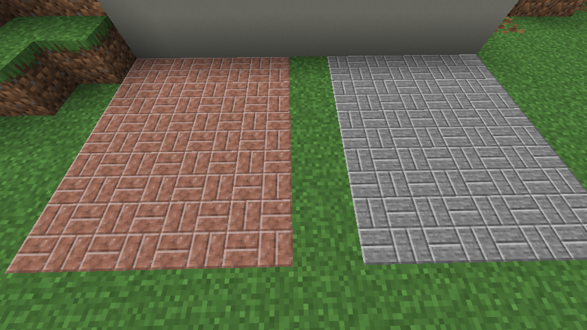
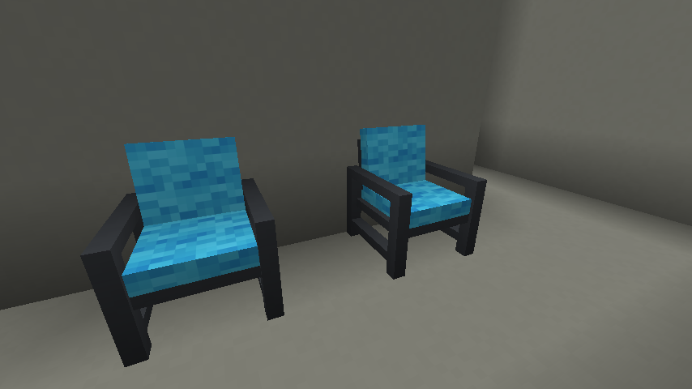
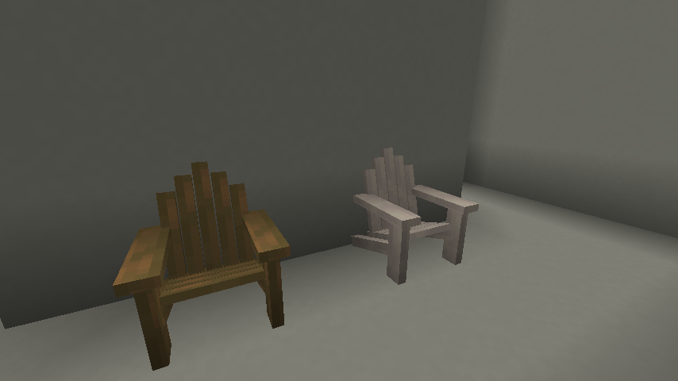
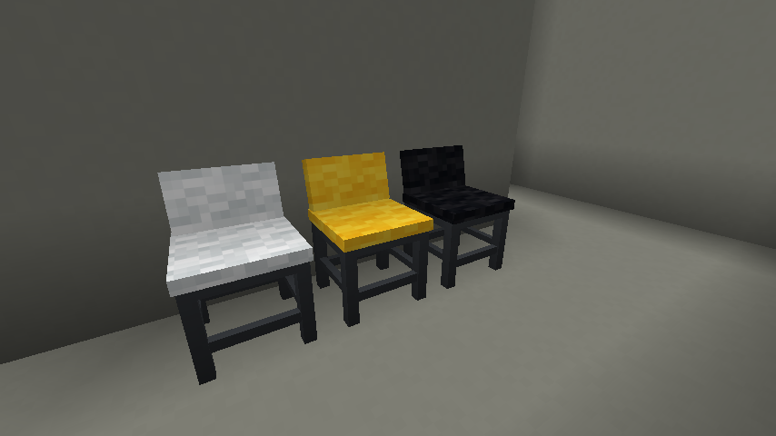

# Decks and patios

[Manual contents](README.md) · [Recipes](recipes.md) · [Catalog](catalog.md)

Build patio floors with granite or stone pavers, then furnish the space with Adirondack chairs, patio chairs, bar stools, and concrete fire pits.

## Pavers



Granite Pavers and Stone Pavers are full 16 × 16 × 16 blocks for patio floors and paths. Mine them with a pickaxe to pick them back up.

Arrange four matching granite or stone slabs (`S`) in a 2 × 2 square to make **2** pavers of that material. Picking up a matching slab unlocks the crafting recipe.

```text
S S
S S
```

A stonecutter turns one full granite or stone block into **1** matching paver.

| Paver | Crafting grid | Stonecutter |
| --- | --- | --- |
| Granite Paver | [4 Granite Slabs](recipes.md#granite-paver) | [1 Granite](recipes.md#granite-paver-from-granite-stonecutting) |
| Stone Paver | [4 Stone Slabs](recipes.md#stone-paver) | [1 Stone](recipes.md#stone-paver-from-stone-stonecutting) |

## Fire pits


A fire pit is a 10-unit-tall concrete block with a gravel bed set one unit below its rim. It comes in all 16 concrete colors, and each color is a separate item (for example, Gray Concrete Fire Pit).

### Craft

Place concrete of the desired color (`C`), a block of gravel (`G`), and a campfire (`F`) like this:

```text
C G C
. F .
```

The recipe yields **2** fire pits. The recipe unlocks when you pick up the matching concrete.

### Joining pits

Fire pits of the **same color** join automatically with their orthogonal neighbors. The wall between two joined pits disappears, so the gravel forms one continuous bed while the outer concrete rim stays 4 units thick. Where four pits meet, the corner post is replaced by gravel. Different colors do not join. A pit joins to neighbors at the same height only. Removing a pit restores the walls and posts of its neighbors.

### Lighting and extinguishing

- A fire pit is placed **unlit**.
- Light it by using **flint and steel** or a **fire charge** on it, or by hitting it with a burning projectile.
- Use any **shovel** on a lit pit to put it out.
- A lit pit emits light level **15**, crackles, and releases smoke. Living creatures standing in a lit pit take fire damage, as with a campfire.
- Each pit is lit and extinguished separately, even when joined. Flames need no fuel and do not burn out.
- The pit cannot cook food and cannot be waterlogged.

## Patio chairs



Patio chairs have a dark gray frame and a pair of wool cushions in any of the 16 dye colors. Each chair seats one player.

### Placement and seating

Place the chair on a sturdy surface with room above for the backrest. The chair faces you when placed. Use it to sit facing the chair's front. Sneak to dismount.

### Crafting and dyeing

Use four iron ingots (`I`) and one block of wool (`C`) in the desired cushion color.

```text
I C I
I . I
```

The recipe yields **1** patio chair and unlocks when you pick up the matching wool. See the [white patio chair recipe](recipes.md#white-patio-chair) for an example.

Use a dye on a placed **white patio chair** to color both cushions. You can also combine one white chair and one dye in a crafting grid. Only white chairs accept dye. See the [blue patio chair dyeing recipe](recipes.md#blue-patio-chair-from-dye) for an example.

## Adirondack chairs



Adirondack chairs come in all 13 wood types. Each has a stripped wood finish, a reclined slatted back, and a seat that slopes down toward the rear. Placement, seating, and dismounting work the same way as for patio chairs.

Use five planks of the same wood type (`P`) to craft **2** chairs. Picking up matching planks unlocks the recipe. See the [spruce Adirondack chair recipe](recipes.md#spruce-adirondack-chair) for an example.

```text
P . .
P P .
P . P
```

## Bar stools



Bar stools have a dark gray frame with a footrest, a cushioned seat 12 units above the floor, and a slightly reclined cushioned back. The cushions come in all 16 dye colors. Placement, seating, and dismounting work the same way as for patio chairs.

Use six iron ingots (`I`) and one block of wool (`W`) in the desired cushion color to craft **1** stool. Picking up the matching wool unlocks its recipe. See the [white bar stool recipe](recipes.md#white-bar-stool) for an example.

```text
I W I
I . I
I . I
```

Use dye directly on a placed **white bar stool** to color both cushions, or combine one white stool and one dye in a crafting grid. Only white stools accept dye. See the [blue bar stool dyeing recipe](recipes.md#blue-bar-stool-from-dye) for an example.


## Troubleshooting

| Symptom | Check |
| --- | --- |
| Pits do not join | They must be the same color, adjacent on the same level, and in a straight line (diagonal contact alone does not join). |
| Pit will not light | Use flint and steel or a fire charge; an already lit pit does nothing. |
| Pit will not go out | Use a shovel; water, rain, and empty hands do not extinguish it. |
| Flames look cut off at the edge | A single pit's flames end at the gravel edge; join a neighbor to extend them. |
