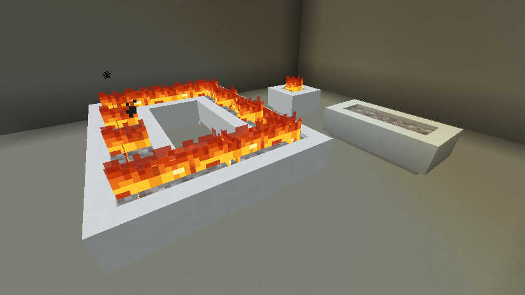

# Decks and patios

[Manual contents](README.md) · [Recipes](recipes.md) · [Catalog](catalog.md)

Outdoor living pieces for decks, terraces, and patios. This chapter currently covers the fire pit.

## Fire pits



A fire pit is a 10-unit-tall concrete block with a gravel bed set one unit below its rim. It comes in all 16 concrete colors, and each color is a separate item (for example, Gray Concrete Fire Pit).

### Craft

Place concrete of the desired color (`C`), a block of gravel (`G`), and a campfire (`F`) like this:

```text
C G C
. F .
```

The recipe yields **2** fire pits. The recipe unlocks when you pick up the matching concrete.

### Joining pits

Fire pits of the **same color** join automatically with their orthogonal neighbors. The wall between two joined pits disappears, so the gravel forms one continuous bed while the outer concrete rim stays 4 units thick. Where four pits meet, the corner post is replaced by gravel. Different colors do not join. A pit joins to neighbors at the same height only. Removing a pit restores the walls and posts of its neighbors.

### Lighting and extinguishing

- A fire pit is placed **unlit**.
- Light it by using **flint and steel** or a **fire charge** on it, or by hitting it with a burning projectile.
- Use any **shovel** on a lit pit to put it out.
- A lit pit emits light level **15**, crackles, and releases smoke. Living creatures standing in a lit pit take fire damage, as with a campfire.
- Each pit is lit and extinguished separately, even when joined. Flames need no fuel and do not burn out.
- The pit cannot cook food and cannot be waterlogged.

## Troubleshooting

| Symptom | Check |
| --- | --- |
| Pits do not join | They must be the same color, adjacent on the same level, and in a straight line (diagonal contact alone does not join). |
| Pit will not light | Use flint and steel or a fire charge; an already lit pit does nothing. |
| Pit will not go out | Use a shovel; water, rain, and empty hands do not extinguish it. |
| Flames look cut off at the edge | A single pit's flames end at the gravel edge; join a neighbor to extend them. |
