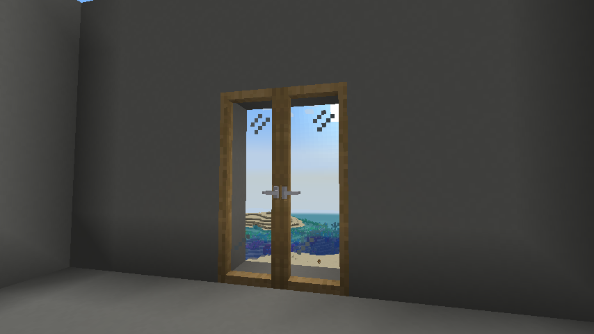
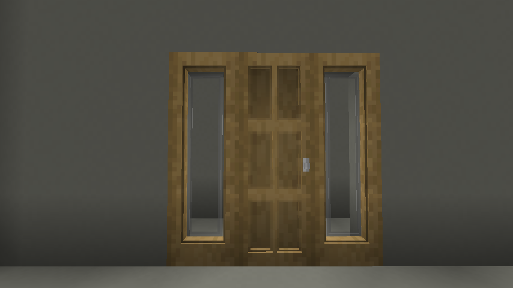
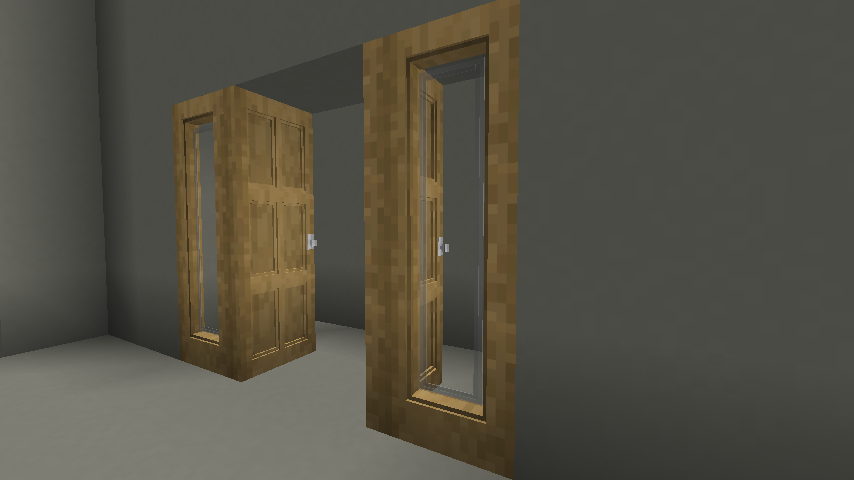
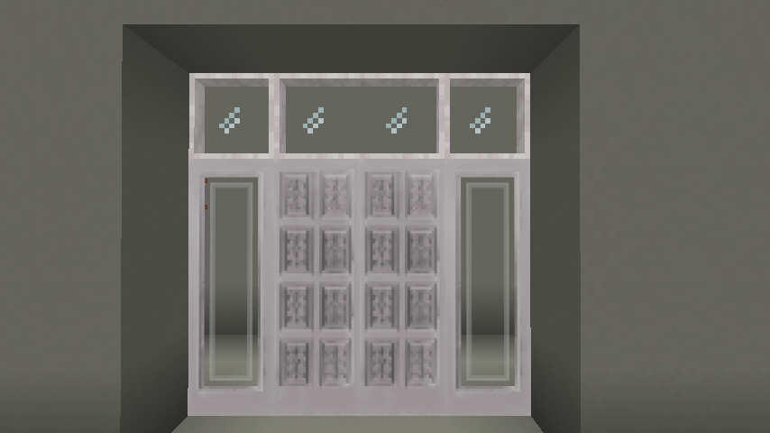
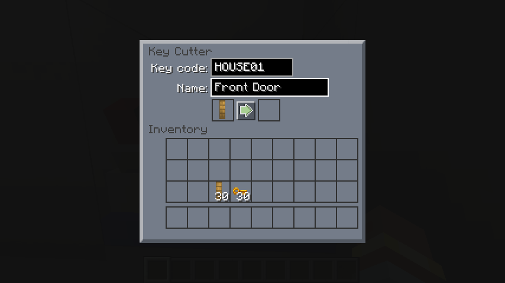
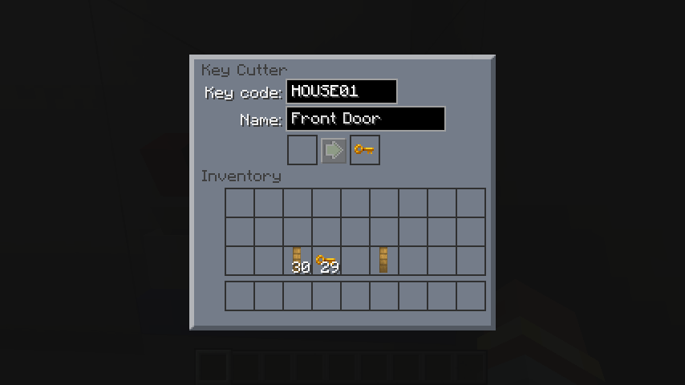
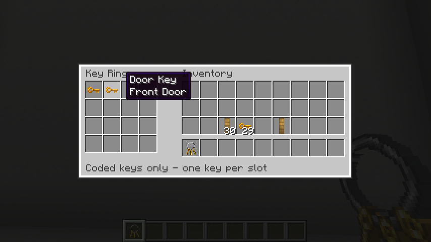

# Tall doors, keys, and access

[Manual contents](README.md)

Tall doors provide three-block-high entrances. The key cutter, door keys, and key rings described here work with tall doors from this mod; they do not add coded access to vanilla doors. You can leave them freely operable or assign a code with a key cutter. A key with the same code operates the tall door; a key ring carries several coded keys and finds a match automatically.

## Obtain the parts

All items in this chapter are **survival obtainable** through bundled crafting recipes. Recipes use a crafting table. In the grids below, `.` is an empty slot.

| Item | Recipe rows, top to bottom | Ingredients | Output |
| --- | --- | --- | --- |
| Tall door | `PP.` / `PPN` / `PP.` | P = matching wood planks; N = gold nugget | 2 tall doors |
| Tall patio door | `WGW` / `WGW` / `WGW` | W = matching wood planks; G = glass block | 4 patio doors |
| Transom | `PGP` | P = matching wood planks; G = glass block | 4 transoms |
| Tall sidelight | `PG.` / `PG.` / `PG.` | P = matching wood planks; G = glass block | 4 sidelights |
| Key cutter | `IDI` / `III` / `...` | I = iron ingot; D = diamond | 1 cutter |
| Door key | `N..` / `N..` / `...` | N = gold nugget | 4 blank keys |
| Key ring | `.N.` / `N.N` / `.N.` | N = iron nugget | 1 ring |

Tall doors, tall patio doors, tall sidelights, and transoms come in oak, spruce, birch, poplar, jungle, acacia, dark oak, mangrove, cherry, pale oak, bamboo, crimson, and warped variants. Their recipes use the corresponding planks.

## Tall doors

*In-game view of tall oak patio doors.*

Place tall doors in an unobstructed three-block-high opening on a solid floor. One item places all three sections. Use any section to open or close an uncoded door. For a pair, use two tall doors of the same wood with the same facing and opposite hinges; the pair occupies a two-block-wide opening. A tall door pairs with the same tall-door variant.

All tall doors (including tall patio doors) support the key cutter, coded door keys, and key rings exactly as described below. Set the same code on both leaves of a pair. The cutter can process a whole stack of tall doors at once. Empty hands and nonmatching keys cannot operate a coded tall door.

Breaking any section removes the complete leaf. In Survival it drops **one tall door item**, preserving the code and descriptive name; Creative breaking drops nothing. Replacing that item restores the coded door.

The placement, pairing, and access instructions in the rest of this chapter apply to both regular tall doors and tall patio doors.

## Place a tall door and sidelights

Prepare a solid floor and an unobstructed opening three blocks high. Each tall door occupies one column; each optional sidelight occupies another. A single tall door with a sidelight on either side needs a three-block-wide opening.

Place each item on the floor while facing the entrance. The middle and upper sections are created automatically. Keep all three spaces clear before placement. A sidelight is a fixed decorative panel; it does not swing open.

Use an uncoded tall door to open or close it. You can interact with the bottom, middle, or top section. The side of the block you click during placement determines the hinge.

<!-- screenshot:doors-01:start -->

*A tall door and two sidelights fill a three-block-wide, three-block-high opening.*
<!-- screenshot:doors-01:end -->

### Paired tall doors

Place two tall doors of the **same wood variant**, facing the same direction with opposite hinges. A correctly paired set opens and closes together. If only one opens, check the variant, facing, and hinges.

Use the same code on both leaves. The current implementation checks access on the tall door you click, then moves its matching neighbor without checking the neighbor's code. Leaving either leaf uncoded allows that leaf to open the pair.

<!-- screenshot:doors-02:start -->

*Paired tall doors open together when their facing and hinges form a pair.*
<!-- screenshot:doors-02:end -->

## Add transoms above an entrance

Transoms are fixed glass panels with a thin wooden frame. Each occupies one block above an entrance and sits at the same depth as a closed tall door or sidelight. Place a transom directly above the top section to align it automatically with that door or sidelight. A three-block-high entrance with transoms needs a four-block-high opening. Transoms may also be placed elsewhere; they do not require a door, sidelight, or supporting block to remain in place.

Two matching transoms merge into one wide pane only when directly above a correctly paired set of tall doors, including tall patio doors. Both transoms must have the same wood and facing. Only the frame at the pair's center disappears: four doors arranged as two pairs produce two separate double-width transoms. Transoms above sidelights, single doors, or ordinary blocks keep their individual frames. Removing a partner transom or a door below restores the remaining frames.

Craft **4 transoms** with one horizontal `PGP` row: two matching wood planks around one **glass block**. Glass panes do not substitute. Obtaining the matching planks unlocks the recipe. Each broken transom drops one matching item.

*Pale oak transoms form a single, double, single arrangement across this four-block-wide entryway.*

## Make a coded entrance with a tall door

For this walkthrough, use a single tall oak door, a key cutter, and one blank door key. The example code is `HOUSE01`; the descriptive name is `Front Door`. These are demonstration values, not recommended codes for a shared server.

1. Keep the tall door in your inventory. Place the key cutter and use it to open its interface; you do not need to hold the tall door item.
2. Put **one tall door** in the left slot. Leave the right output slot empty.
3. Enter `HOUSE01` in **Key code:** and `Front Door` in **Name:**.
4. Press the small button between the slots to set the code. Take the tall door from the right slot.
5. Put **one blank door key** in the left slot. Enter the same code, `HOUSE01`, and a useful name such as `Front Door`. Press the button and take the key from the right slot.
6. Place the coded tall door in your prepared opening.
7. With an empty hand, try using the tall door: it should stay closed. Hold the matching key and use the tall door: it should open. Use the key again to close it.

The code field accepts up to **10 characters**. Codes must match exactly, including capitalization and spaces. The name is a descriptive tooltip label; matching names do not grant access. A blank code leaves a tall door freely operable.

The cutter edits the input stack and moves it to the output. Use one item at a time while learning; a stack is processed together. It does not require a second key, fuel, or additional materials to set a code. Take the output before processing another item. Items left in the cutter menu are returned when it closes, with overflow dropped if necessary.

<!-- screenshot:doors-03:start -->

*Set the tall door's code before placing it in the world.*
<!-- screenshot:doors-03:end -->

<!-- screenshot:doors-04:start -->

*A key with the same code can operate the coded tall door; the descriptive name is only a label.*
<!-- screenshot:doors-04:end -->

## Carry keys on a ring

Hold a key ring and use it while aiming into the air. Its interface has **16 slots**, each holding one coded door key. Click, drag, or shift-click to move keys between the ring and your inventory. Blank keys and other items are rejected.

The open ring stays fixed in its inventory slot until you close the interface. Its contents stay with the item. The ring looks bare when empty and shows gold keys when it contains at least one key.

Close the interface, hold the ring, and use it on any section of a coded tall door. A matching key anywhere on the ring opens or closes it; you do not need to select that key. An empty ring or one with only different codes cannot operate the coded tall door. An uncoded tall door can be operated even with an empty ring.

You can rename an empty or filled ring in an anvil. For a fresh ring, renaming costs one experience level. The keys and their codes are preserved, and the custom name becomes the ring interface title. Clear the anvil's name field to restore the default name.

<!-- screenshot:doors-05:start -->

*A ring holds up to sixteen coded keys and automatically uses a matching one.*
<!-- screenshot:doors-05:end -->

## Share or change access

To share access, code additional keys with the same code and give them to the other players. Multiple tall doors can share a code, allowing one key to operate them all. The code controls access, not the player's identity or the key's descriptive name.

Breaking any of a tall door's three sections removes the entire tall door. **The dropped tall door item keeps its code and descriptive name.** You can pick it up and place it again without recoding it; the same keys will still work.

To change an installed tall door's code, remove the tall door, set a new code on its item in the key cutter, and place it again. Simply breaking and replacing a tall door does not change or clear its code.

To revoke old keys, assign a new code to every affected tall door and distribute newly coded keys. Recode both leaves of a pair of tall doors. Changing a key alone does not change a tall door. To remove a code intentionally, process the tall door item with an empty code field.

These locks control interaction; they do not prevent players from breaking blocks or walking through an entrance left open. Tall doors stay open until operated again. Tall doors do not implement vanilla-style redstone opening in the current source. Server owners should treat these behaviors as part of their access policy.

## Troubleshooting

| Symptom | Check |
| --- | --- |
| Cutter button is disabled | Put a supported tall door or door key in the left slot and empty the right slot. Sidelights and rings cannot be coded. |
| Key name matches, but tall door stays closed | Match the actual code exactly; the name does not control access. |
| Ring will not accept a key | Set a non-empty code on a door key first. Each ring slot holds only one key. |
| Ring will not move in inventory | Close the ring interface first. |
| Replaced tall door still needs the old key | Tall doors retain their codes when broken. To change access, set a new code on the tall door item in the key cutter before placing it again. |
| Paired tall doors only open one leaf | Use the same wood variant and facing, with opposite hinges. |
| Locked tall-door pair opens through the other leaf | Both leaves need the same code; the clicked leaf is the one checked. |
| Tall door faces or swings the wrong way | Reposition it and adjust the placement click. The recovered tall door item retains its code and descriptive name. |
