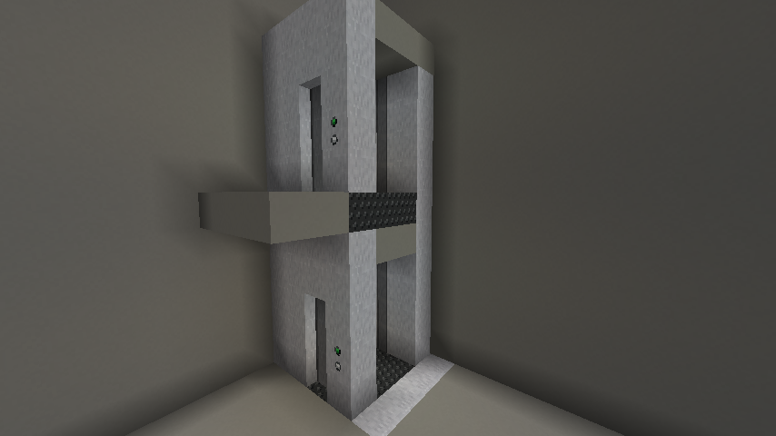
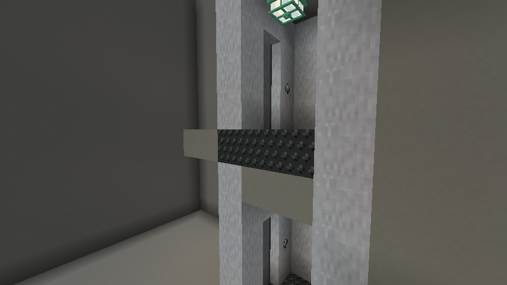
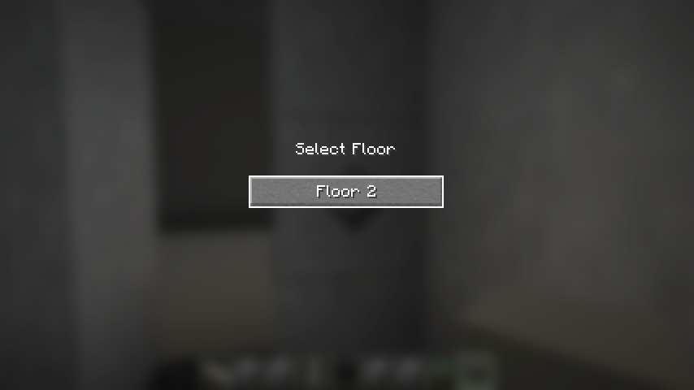

# Elevators

[Manual contents](README.md) · [Recipes](recipes.md) · [Reference](reference.md)

Elevators connect fixed landing areas through a straight vertical column of elevator shaft panels. The system discovers floors from blocks in the world, opens sliding doors, and transfers occupants between landing areas. It does not move a constructed cabin through the world.

## Parts and layout rules

| Part | Role |
| --- | --- |
| Elevator shaft panel | Forms one continuous vertical column linking stops |
| Elevator floor | Makes a horizontally connected landing footprint at one height |
| Elevator call button | Reserves the shaft and opens the current landing; occupies two blocks vertically |
| Elevator destination control | Marks a boardable area and opens the floor-selection screen; occupies two blocks vertically |
| Elevator door | Three-block-high sliding entrance driven by the elevator system |
| Brushed stainless steel | Decorative construction material and recipe ingredient; does not replace functional floor or shaft blocks |

The call button and destination control must stand **directly on elevator floor blocks**. Elevator doors must also have elevator floor blocks directly underneath their bases. A valid floor footprint must touch exactly **one shaft-panel column**, horizontally at its own floor height. A nearby shaft with a gap between it and the floor does not count. Touching two different columns makes that footprint ambiguous and unusable.

Connected elevator floor blocks at the same height form a footprint, up to **256 blocks**. Diagonal-only contact does not connect them. The shaft scan checks up to **256 blocks above and below** its starting panel, stopping at a gap. Use a continuous straight column and modest floor spacing for the first build.

## Build your first two-floor elevator

This example uses two identical 3 × 3 floors six blocks apart. The shaft column sits behind the cabin, opposite the entrance. The call button and destination control flank the door: the call button faces the approach, while the destination control faces into the cabin. Coordinates are relative to your chosen base height **Y**; pick an open test site with room above both stops. The arrangement follows the author's example build; the author confirmed completion of its in-game checks on October 10, 2026.

Gather **18 elevator floor blocks, 7 shaft panels, 2 call buttons, 2 destination controls, and 2 elevator doors**. One door item creates one three-high column. Add ordinary blocks for access paths, walls, and any supports you want around the test build. Use the recipe reference for Survival ingredients; Creative is convenient for a first layout check.

Build this top view at both Y and Y+6. **North / rear is at the top; south / entrance is at the bottom.** North is toward smaller Z. Every `F`, `C`, `D`, and `E` position has an elevator floor block at the landing height. `S` is the shaft column; `C` is the call button, `D` the destination control, and `E` the elevator door. A dash marks a position outside the functional layout.

| Position | X=1 | X=2 | X=3 |
| --- | :---: | :---: | :---: |
| Z=-1 (rear) | — | S | — |
| Z=0 | F | F | F |
| Z=1 | F | F | F |
| Z=2 (entrance) | C | E | D |
| Control faces | South (outward) | — | North (inward) |

1. Place a 3 × 3 elevator-floor square at X=1..3, Z=0..2, height Y. Repeat at height Y+6.
2. Place shaft panels at X=2, Z=-1 for every height from Y through Y+6 inclusive. This single column touches the center of each floor's rear edge, opposite the door.
3. At each stop, place a call button at X=1, Z=2, one block above the elevator floor. Stand south of it and look north when placing, so its button faces outward toward the approach. Leave its next block above clear; it creates its upper section automatically.
4. Place a destination control at X=3, Z=2, one block above each floor. Stand inside the cabin, north of that position, and look south when placing, so its control face points north into the cabin. It also creates an upper section. The two controls now stand on opposite sides of the door, facing the sides from which they are used.
5. Place an elevator door at X=2, Z=2, one block above each floor. Stand south of the opening and look north when placing. Leave the next two spaces above the base clear.
6. Add an ordinary approach platform south of each entrance, extending across the call-button position as well as the doorway. Keep it outside the elevator-floor footprint. Leave the interior clear and use matching room dimensions at both stops.
7. Frame the entrance and add ordinary rear and side wall blocks around the functional parts. Keep the east side (the side beyond X=3) open for the construction illustrations. Do not cover either control face or replace any of the nine elevator floor blocks. The open side exposes the rear shaft and the inside of the entrance without changing the functional layout.
8. From the approach, use the outward-facing call button. Enter through the door, then use the inward-facing destination control beside it to select the other floor as described below.

Do not fill the whole boundary with shaft panels: the floor needs to touch one column, not a wall of different shaft columns. A doorway or ordinary wall around the example is decoration; the functional discovery comes from the floor/control/panel arrangement.

The two construction views below use the **same build with its east side left open**. The front three-quarter view shows the door, exterior call button, and rear shaft panels. The rear three-quarter view looks into the cabin toward the inside of the door and destination control.

<!-- screenshot:elevator-01:start -->

*The call button faces the approach beside the door; the shaft panels sit opposite the entrance at the rear.*
<!-- screenshot:elevator-01:end -->

<!-- screenshot:elevator-03:start -->

*Inside the cabin, the destination control faces the passenger from the other side of the doorway.*
<!-- screenshot:elevator-03:end -->

## Call, board, and travel

1. Use the call button with an empty hand. If the layout is valid and the shaft is free, the elevator reserves that shaft and opens the landing's elevator doors.
2. Move fully into the landing's cabin area. Keep everyone who should travel inside before choosing a destination.
3. Use the destination control. It opens the selection screen only when this floor owns the active reservation and is not already in transit, and another stop exists.
4. Choose the destination. Doors close, occupants are transferred, and the destination opens after a short delay.
5. Exit the destination area. Once the cabin is empty, the reservation releases after the short empty-cabin delay and door animation.

Displayed floors start at **Floor 1** for the lowest detected stop. They are ordered by height, with higher floors at the top of the selection screen. Adding or removing elevator-floor patches can renumber stops; floor names and numbers are not saved as custom labels.

<!-- screenshot:elevator-02:start -->

*Floor numbering follows height; the current stop is omitted from the destination choices.*
<!-- screenshot:elevator-02:end -->

## Status and multiplayer behavior

The call-button state has three meanings: **idle** (valid and unreserved), **busy** (a reservation exists), and **invalid** (no usable floor/shaft relationship). Busy can include a reservation at the same landing; it does not necessarily mean another player is traveling.

One reservation exists per shaft column per dimension. Other calls cannot take that shaft until it releases. Occupancy is checked every 10 ticks. A boarded cabin that becomes empty waits 20 ticks before release; a called but unboarded cabin has a 600-tick empty timeout. At the normal 20 ticks per second these are about one and thirty seconds, plus polling and animation time. Server lag changes real-time duration.

Players, mobs, dropped items, and vehicles in the detected cabin area can affect occupancy or travel. Remove stray entities if a shaft appears permanently busy. Decorative hanging entities are excluded. Test ridden entities and multiple passengers on the actual server before relying on those arrangements.

## Cabin boundaries and advanced layouts

A cabin is a floor footprint with a destination control directly above one of its floor blocks. Its travel area is the footprint's **rectangular bounding box**, extending five blocks upward from the top of the floor. L-shaped footprints therefore include the gap inside their rectangle. Keep that area clear and use identical footprints at the destinations: the transfer offsets positions between the lower corners of these rectangles rather than searching for a safe empty position for each traveler.

Separate footprints touching the same shaft at the same height become one stop. If several have controls, their bounding boxes are combined, potentially including the space between them. A call-button-only footprint can act as a waiting area, but a destination needs a footprint with a control to receive travelers. Prefer one rectangular cabin per height until the basic build is verified.

Elevator doors are controlled by the elevator; clicking them does not manually toggle them. Adjacent doors of the same facing can make a wider sliding entrance. Click the half of the placement block toward which each door should retract; for a double entrance, click the outer half for each leaf. Adding or removing neighboring doors preserves that choice. They are separate from coded tall doors and do not use door keys or key rings.

## Troubleshooting

| Symptom | Check |
| --- | --- |
| Call button does nothing or shows invalid | Its base must be directly on an elevator floor patch touching exactly one shaft column. |
| Upper floor is missing | Check the uninterrupted vertical panel column and horizontal contact at that floor's height. |
| Destination control does nothing | Call this floor first, wait for it to be ready, and ensure another stop exists. |
| A floor appears but selecting it does nothing | Give its footprint a destination control; a floor-only or call-only stop has no receiving cabin. |
| Doors do not open | Put door bases directly on elevator floor blocks in a footprint containing a destination control. |
| Elevator stays busy | Check for players, mobs, dropped items, or vehicles still inside the full cabin bounding box; allow timeout/animation time. |
| Travelers arrive inside obstacles | Match cabin footprints and keep the corresponding arrival volume clear. |
| Controls fail after expansion | Check for multiple touched shaft columns or a connected floor exceeding 256 blocks. |
