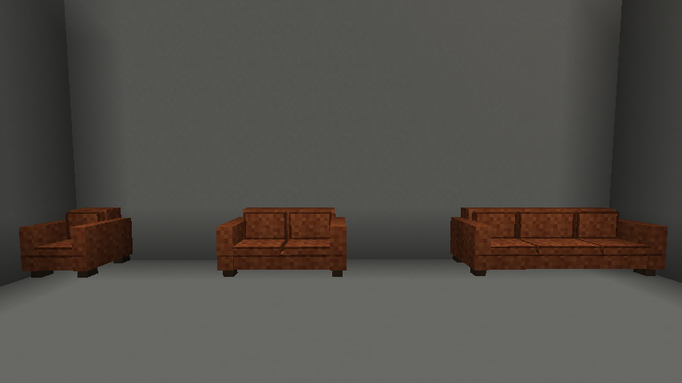
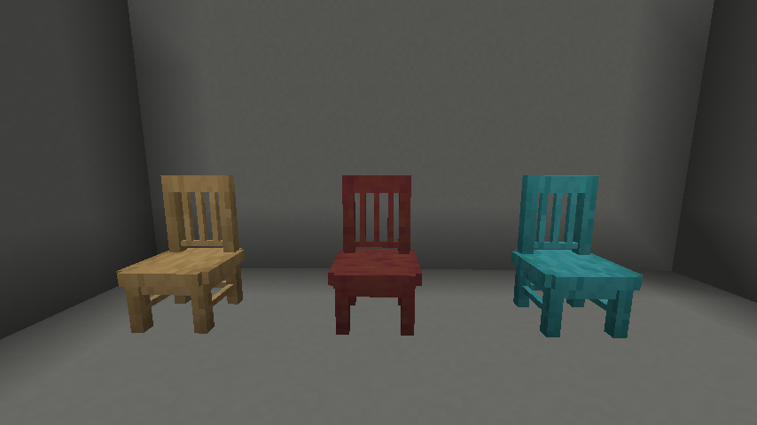
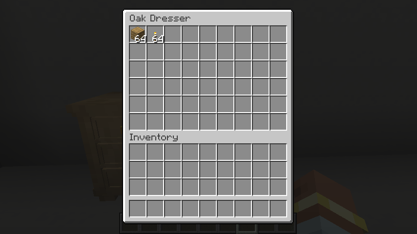
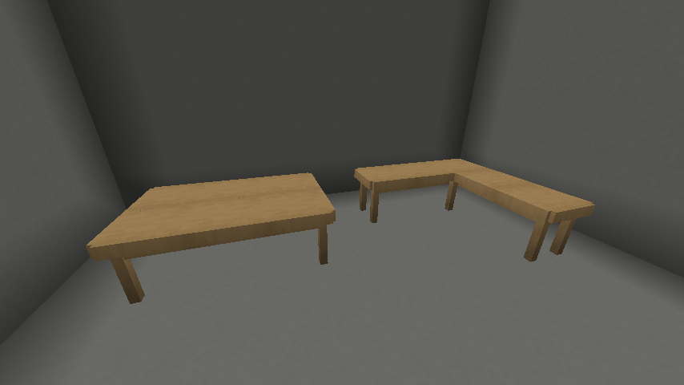
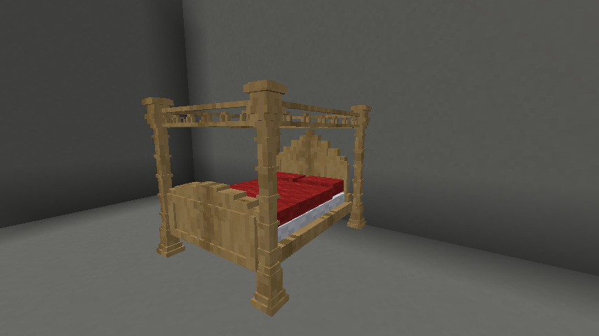

# Furniture and storage

[Manual contents](README.md) · [Recipes](recipes.md) · [Catalog](catalog.md)

Furniture combines decorative models with seating, storage, or sleeping behavior. Most pieces face the player when placed. Use an empty hand to interact, and leave room for the whole piece rather than only its visible feet.

## Space and function

Dimensions below are the block spaces to reserve, in width × depth × height. A model may be smaller than its reserved space.

| Furniture | Space | Function |
| --- | --- | --- |
| Leather chair | 1 × 1 × 1 | One seat |
| Dining chair | 1 × 1 footprint; 1½ blocks high | One seat; sitting turns you toward the chair's front |
| Leather love seat | 2 × 1 × 1 | Two seating positions |
| Leather sofa | 3 × 1 × 1 | Three seating positions |
| Side table | 1 × 1 × 1 | Decorative surface; no inventory |
| Dining table | 1 × 1 × 1 per block | Joins matching tables into a larger decorative surface; no inventory |
| Nightstand | 1 × 1 × 1 | 27 storage slots |
| Dresser | 2 × 1 × 2 | One shared 54-slot inventory; model is about 1¼ blocks high |
| Four-post bed | 2 × 3 × 2 | Two mattress-side sleeping positions; normal sleep/spawn restrictions |

## Chairs, love seats, and sofas

Place on a sturdy floor. The love seat places both sections together; the sofa places its middle section at the clicked position and extends to either side. Keep those neighboring spaces free. Use a seating section with an empty hand to sit there. Sitting turns your head, body, and view toward the furniture's front. An occupied section cannot take another passenger, and a player already riding something must dismount first. Use the normal dismount control to get up onto clear floor beside your cushion. If every exit is blocked, you are placed slightly above that furniture section, clear of its arms and backrest. Other seated players stay in their own cushions.

Breaking a section of a love seat or sofa removes the complete piece and clears its seating entities. These are leather furniture items, not dyeable upholstery families; their wool recipe ingredient does not determine a fabric color.

<!-- screenshot:furniture-01:start -->

*Chair, love seat, and sofa provide one, two, and three seating positions.*
<!-- screenshot:furniture-01:end -->

## Dining chairs

Dining chairs have an open slatted back, square legs, and a stripped wood finish. Each item places one chair with its front facing you. Place it on a sturdy floor and keep room above for the back, which reaches 1½ blocks high.

Use an empty hand without sneaking to sit. An occupied chair cannot take a second player, and you must dismount another vehicle before sitting. Use the normal dismount control to stand up onto clear floor beside the chair. If all exits are blocked, you are placed slightly above the seat. Breaking the chair or removing its floor support dismounts its rider and clears the seat.

All 12 woods are available: oak, spruce, birch, jungle, acacia, dark oak, mangrove, cherry, pale oak, bamboo, crimson, and warped.

The recipe is `TTT` / `LLL` / `T.T`, where `T` is a stick and `L` is a matching wood slab. Five sticks and three matching slabs yield **two chairs** of that wood.

<!-- screenshot:furniture-05:start -->

*Oak, mangrove, and warped dining chairs share the same slatted-back design with different stripped wood finishes.*
<!-- screenshot:furniture-05:end -->

## Tables, nightstands, and dressers

Side tables offer a supported top for a lamp but do not open a storage screen. Nightstands offer the same room-scale footprint with a three-row storage menu. Dressers need two blocks of width and two block spaces of height; their upper sections occupy only part of those spaces.

Use a nightstand or any dresser section to open storage. Click, drag, or shift-click items as in a normal chest interface. A dresser's sections share one inventory, not separate drawers. Storage fullness can be read by comparators. Breaking the storage furniture drops its contents; it is not a portable filled container like a key ring. Empty it first when moving a room's furnishings.

These three families each have 12 woods: oak, spruce, birch, jungle, acacia, dark oak, mangrove, cherry, pale oak, bamboo, crimson, and warped. Match a species across pieces to create a coordinated room.

<!-- screenshot:furniture-02:start -->

*The complete dresser shares one 54-slot inventory.*
<!-- screenshot:furniture-02:end -->

## Dining tables

Place dining table blocks side by side on a sturdy floor to build a table of your chosen size and shape. Each item places one block. Matching wood varieties join along their edges at the same height, forming a continuous tabletop and an apron around the perimeter. Different woods, side tables, and blocks touching only diagonally remain separate.

A single dining table has the same proportions as a side table. Joined tables keep legs at outside corners and at inward corners, such as the bend of an L. Straight edges and filled interior corners have no legs. A 2 × 3 rectangle made from six blocks has four legs; a three-block L has six, including the leg at its inward corner. Every block still needs support underneath, even where there is no visible leg. The tabletop supports lamps and other suitable decorations, and has no storage screen.

All 12 woods are available: oak, spruce, birch, jungle, acacia, dark oak, mangrove, cherry, pale oak, bamboo, crimson, and warped. Each finish combines a wood-colored base with softened stripped-wood grain.

Craft four tables with the pattern `PWP` / `P.P`, where `P` is matching planks and `W` is matching stripped wood. For bamboo, use a stripped bamboo block; for crimson and warped, use matching stripped hyphae. See the [oak recipe](recipes.md#oak-dining-table) or choose another wood in the [catalog](catalog.md). The recipes yield four blocks of the selected variety.

Add or remove individual blocks to reshape a table; neighboring tops, aprons, and legs adjust automatically. Breaking one block drops that table item and leaves the remaining supported blocks in place.

<!-- screenshot:furniture-04:start -->

*Matching dining tables join into rectangles and L shapes, with legs only at outside and inward corners.*
<!-- screenshot:furniture-04:end -->

## Four-post beds

Reserve a supported 2 × 3 floor area and two clear block spaces above that footprint. Stand at the foot and look toward the head when placing the bed. The whole structure is placed from one item, and removing a section removes the whole bed.

Use the bed to sleep. Interaction is routed to the middle mattress position on the clicked side. Each side has its own occupied state. Normal restrictions still apply: an occupied side cannot accept another sleeper, and sleep problems are reported by the game's usual messages. Leave clear space beside or at the ends of the bed for waking and respawning.

**Beds explode in dimensions where beds cannot set spawn**, as vanilla beds do. Use the Overworld for the first demonstration.

Four-post beds have 16 bedding colors and 12 woods: oak, spruce, birch, jungle, acacia, dark oak, mangrove, cherry, pale oak, bamboo, crimson, and warped. Bamboo beds use stripped bamboo frames and are crafted with bamboo blocks (regular or stripped) and matching vanilla beds. See the [catalog](catalog.md) for all variants.

<!-- screenshot:furniture-03:start -->

*Reserve the full two-by-three footprint and two block spaces of height.*
<!-- screenshot:furniture-03:end -->

## Troubleshooting

| Symptom | Check |
| --- | --- |
| Sofa, dresser, or bed will not place | Clear its complete footprint and upper spaces; check support below every lower section. |
| Clicking a side table does nothing | It has no storage; use a nightstand for an inventory. |
| Dining tables do not join | Use the same wood variety at the same height, sharing an edge. Side tables do not join dining tables. |
| Dining table has fewer legs after joining | Expected: only outside and inward corners have legs. Every block still needs a sturdy floor beneath it. |
| Cannot sit | Use an empty hand, choose an unoccupied section, and dismount any current vehicle. |
| Storage items scatter when furniture is broken | Contents drop separately. Collect them or empty the furniture before moving it. |
| Bed refuses sleep | Read the game's message, check the selected side, and follow normal sleep rules. |
| Bed has no safe wake-up location | Clear nearby floor space beside the bed and at its ends. |
