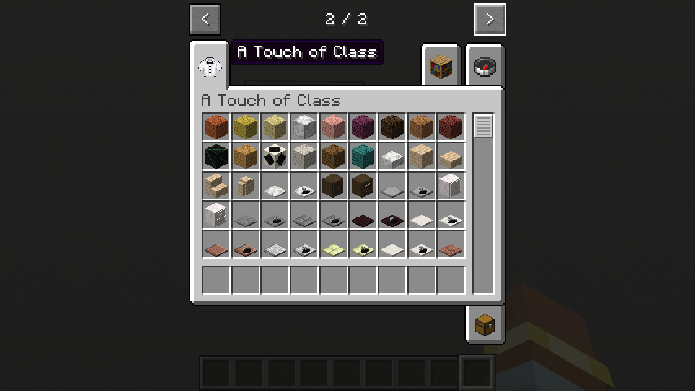
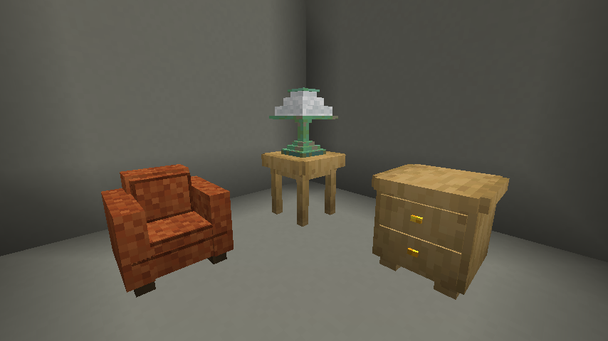

# Welcome and getting started

[Manual contents](README.md) · [Reference](reference.md)

A Touch of Class adds architectural finishes, furniture, lighting, kitchen and bathroom fittings, coded tall doors, and elevators. You can build a furnished home in Survival or explore the full palette in Creative. This manual describes the current Minecraft 26.3 source tree; modpacks can change recipes and other behavior.

## Install and check the mod

1. Use Minecraft **Java Edition 26.3** with a compatible **NeoForge 26.3.0.92** installation. This checkout declares **26.3.0.92** as its minimum NeoForge version; use the version supplied with your mod build or modpack.
2. Close the game, if already running. Place the A Touch of Class mod JAR in the `mods` folder of that game instance. Do not unzip the JAR. Avoid keeping two versions of the same mod in the folder.
3. Launch that NeoForge instance. Check the Mods screen for A Touch of Class, then open a test world.
4. In Creative inventory, find the **A Touch of Class** tab. In Survival, use the crafting recipes in the [recipe reference](recipes.md).
5. For multiplayer, install matching mod builds on the server and clients. See the [server owner guide](server-owners.md).

Java 25 is the runtime baseline for this target. Follow the [NeoForge user guide](https://docs.neoforged.net/user/docs/) for launcher and Java setup. The repository's declared mod version is 1.2.0; that identifies this source configuration, not a guarantee that a public release exists.

<!-- screenshot:start-01:start -->

*The mod Creative tab is the starting point for exploring the complete palette.*
<!-- screenshot:start-01:end -->

## Controls and common placement rules

“Use” means right-click with default controls; “break” means the normal attack/mine action. An empty hand is a useful starting point when interacting with furniture. To place something against a storage block without opening its menu, use the normal sneak-place action.

Many furnishings occupy more than one block space. Reserve the complete volume, including visually empty portions of a model. Place on a solid, full-block floor for your first build. Furniture facing normally depends on which direction you are looking; trim often depends on the face or edge you click. Each feature chapter describes the exceptions.

## Furnish your first room

This small project uses only craftable items and introduces seating, storage, and lighting. Start with a room at least five blocks wide, five blocks deep, and four blocks high inside, with a solid floor. A vanilla entrance is fine for this walkthrough; coded access requires the mod's [tall doors](doors-and-access.md).

Gather 3 oak slabs and 2 oak planks for a side-table recipe; another 3 oak slabs and 5 oak planks for a nightstand recipe; 1 leather, 1 wool of any color, and 1 wooden slab for a chair; and 1 white wool, 1 torch, and 2 copper ingots for a table lamp. These totals assume you already have the slabs and other ingredients.

| Craft | Grid rows, top to bottom (`.` = empty) | Result |
| --- | --- | --- |
| Oak side table | `SSS` / `P.P` / `...`; S = oak slab, P = oak planks | 3 tables |
| Oak nightstand | `SSS` / `PPP` / `P.P`; S = oak slab, P = oak planks | 3 nightstands |
| Leather chair | `L..` / `W..` / `S..`; L = leather, W = wool, S = wooden slab | 1 chair |
| Copper table lamp | `WT.` / `.C.` / `.C.`; W = white wool, T = torch, C = copper ingot | 1 lamp |

1. Place a side table one block away from a wall. Place the table lamp on its top.
2. Place the chair beside the table with its front facing the room. Use it with an empty hand to sit; use your dismount control to stand up.
3. Place a nightstand against another wall. Use it to open its 27-slot inventory, deposit an item, close it, and open it again.
4. Check the lamp at night: it emits light without fuel or power. Copper can change appearance as it oxidizes; [waxing](lighting.md) preserves a finish.
5. Add wall finishes or trim using the [building guide](building.md), or expand with a bed from the [furniture guide](furniture.md).

<!-- screenshot:start-02:start -->

*A first room introduces seating, storage, and lighting with craftable items.*
<!-- screenshot:start-02:end -->

## Choose your next project

- **Players:** decorate with [wall finishes](building.md), build a [kitchen](kitchens-and-bathrooms.md), or follow the [two-floor elevator walkthrough](elevators.md).
- **Server owners:** review [installation, shared access, backups, and troubleshooting](server-owners.md).
- **Modpack authors:** use the [customization guide](modpack-authors.md) and [catalog](catalog.md) for exact identifiers and acquisition routes.

Concrete countertops and sinks are **Survival obtainable** in all 16 colors. Three matching vanilla concrete slabs craft six countertops or six sinks, using the grids in the [kitchen guide](kitchens-and-bathrooms.md#concrete-countertops-and-sinks). Obtaining a slab unlocks both recipes for that color.

## If something goes wrong

A missing Creative tab usually means the wrong game instance or mod build was launched. A placement that does nothing often means the full volume or required support is missing. A recipe that differs from this manual may have been changed by your modpack. Use the [troubleshooting checklist](reference.md) to collect the details needed to investigate.
