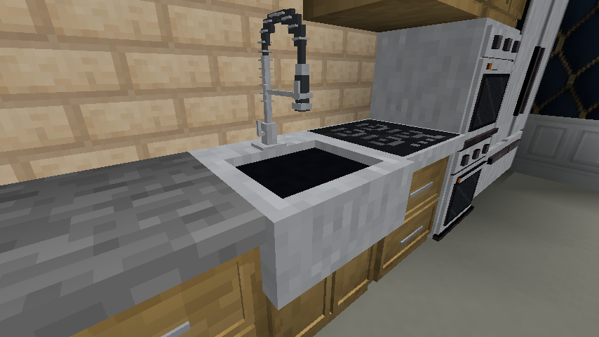
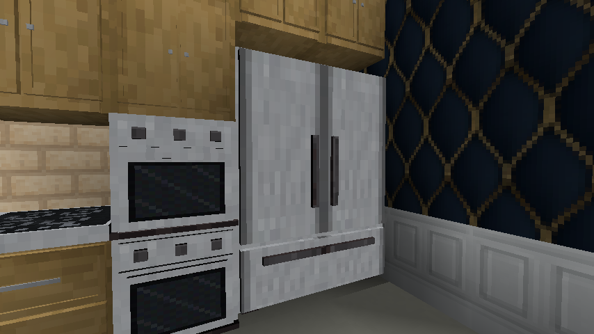
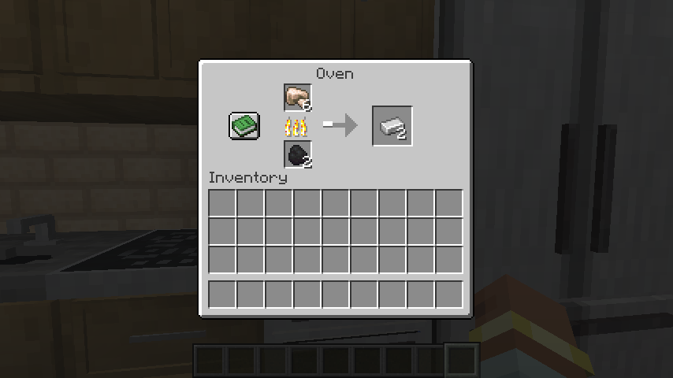
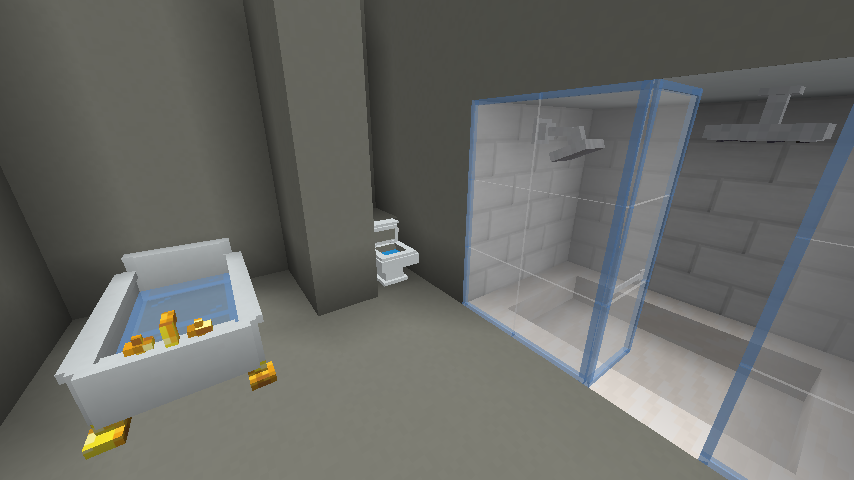

# Kitchens and bathrooms

[Manual contents](README.md) · [Recipes](recipes.md) · [Catalog](catalog.md)

Build the supporting room first, then add storage and fittings. The table below distinguishes implemented interactions from appearance; no pipes or electrical power network are required by these furnishings.

| Fitting | Implemented behavior |
| --- | --- |
| Door/drawer cabinet | 27-slot storage per block |
| Refrigerator | 54-slot storage shared across the appliance |
| Oven | Furnace-style smelting with input, fuel, and output |
| Induction cooktop | Decorative surface; adjacent matching cooktops can pair visually |
| Countertop and sink | Decorative surfaces; sinks have no fluid inventory or faucet interaction |
| Stainless steel kitchen sink | Two side-by-side sinks with the same facing share a center sprayer faucet |
| Clawfoot bathtub | Use to toggle its filled appearance |
| Toilet | Use to sit with the lid open or closed; Shift + use with an empty hand toggles the lid |
| Shower heads | Decorative fittings; no flowing-water interaction |
| Glass shower surround | Fixed panels with connections |
| Glass shower door | Use to open or close it |

## Cabinets and work surfaces

Cabinets come in door and drawer styles across the 12 woods in the [reference](reference.md). Use one with an empty hand to open its inventory. Each cabinet keeps its own 27 slots; stacking cabinets does not merge inventories. Door cabinets of the same wood and facing connect their appearance vertically.

Place countertops or sinks on top of the base units. Sneak-place against a cabinet to avoid opening it. These surfaces occupy their own block space; the countertop is a thin ⅛-block slab at the bottom of that space. Sinks add a basin model and faucet within that space. They are decorative and do not supply water buckets.

Stone-based, copper, and other material variants have individual recipes. All **32 concrete countertops and sinks** (16 colors of each) are intentionally **Creative only**. Crafting is deferred until the mod targets a Minecraft version with vanilla concrete slabs; no release date is promised. Survival kitchen examples use calcite or another craftable material instead.

The **Stainless Steel Kitchen Sink**  is farmhouse style with a front apron. Place a second sink beside it with the same facing to form a double sink with one shared sprayer faucet. Pairs stop at two sinks; adding another sink leaves the existing pair intact. Breaking either half restores the remaining sink's single appearance. The apron is decorative and does not block access to the cabinet below.

Like the other sinks, it has no fluid inventory or water interaction.

<!-- screenshot:kitchen-01:start -->

*Cabinets store items; countertops, sinks, and cooktops complete the kitchen appearance.*
<!-- screenshot:kitchen-01:end -->

## Refrigerator

Reserve a **2-wide × 1-deep × 3-high** space on a sturdy floor. The six sections form one refrigerator; you do not place each section separately. Use any section to open the six-row, 54-slot inventory.

This is storage, not a food-preservation simulation: it does not require power, consume coolant, or change item spoilage. Its inventory can hold ordinary items, not only food. Breaking a section removes the appliance and drops its stored contents. Empty it before relocating it.

<!-- screenshot:kitchen-02:start -->

*The refrigerator reserves a two-by-one-by-three volume and shares 54 storage slots.*
<!-- screenshot:kitchen-02:end -->

## Oven and induction cooktop

The oven occupies one block and uses the familiar furnace screen. Put a smeltable input in the upper slot and furnace fuel in the lower slot; collect the output on the right. It uses **smelting recipes**, so it is not restricted to food. The oven lights while burning and emits light level 13 in that state. It uses fuel rather than an electrical connection.

For a straightforward demonstration, use raw iron and coal and wait for an iron ingot. The exact available recipes and fuel behavior can be changed by a modpack.

The induction cooktop is a decorative, countertop-height piece. Place it in the block space above an oven or cabinet. Two cooktops next to one another, with the same facing, form a visual pair; adding a third does not create an unlimited merged surface. There is no cooktop inventory, cooking progress, or power input.

<!-- screenshot:kitchen-03:start -->

*The oven uses furnace smelting recipes, not just food recipes.*
<!-- screenshot:kitchen-03:end -->

## Bath and toilet

The clay toilet and clay clawfoot bathtub are crafting intermediates; follow their firing recipes in the [recipe reference](recipes.md) to obtain the finished fittings.

The clawfoot bathtub's visible body is about **1½ × 2½ blocks**, but it occupies a **3 × 3 × 1** arrangement of block sections. Keep the full area clear and supported. Use any section to toggle the filled appearance across the whole tub; no water bucket is required. It does not behave as a fluid tank. Breaking one section removes the complete tub.

The toilet occupies one block and seats one player at a time. Right-click it to sit with the lid either open or closed. Sitting leaves the lid in its current state; press Shift to stand up. Breaking an occupied toilet also dismounts its rider.

To open or close the lid, hold Shift and right-click the toilet with an empty hand. This plays the lid interaction sound. The toilet does not offer storage or a waste-processing mechanic.

## Shower fittings

Wall shower heads attach to a supporting wall; rain shower heads attach underneath a supported ceiling. They are decorative rather than water emitters.

Glass shower surrounds and shower doors are three blocks high. Place on a supported base with all three spaces clear. Surrounds connect to neighbors of the same facing. Shower doors swing when used; their hinge depends on the placement click. These doors are separate from the coded tall-door system and cannot be coded with the key cutter.

<!-- screenshot:kitchen-04:start -->

*Use the bath to toggle its filled appearance. The toilet offers seating and a lid toggle; shower heads are decorative fittings.*
<!-- screenshot:kitchen-04:end -->

## Troubleshooting

| Symptom | Check |
| --- | --- |
| Sink, shower, or cooktop has no interface | These are decorative; the oven and storage units have interfaces. |
| Tall pantry looks connected but storage is separate | Each cabinet retains its own inventory. |
| Fridge or bathtub will not fit | Check reserved block spaces, not just the visible model dimensions. |
| Oven does not cook a particular item | It accepts furnace smelting recipes and needs valid fuel plus room for output. |
| Cooktops do not join | Check that both are unpaired neighbors with the same facing. |
| Concrete sink has no recipe | This is intentional Creative-only content. |
| Shower door does not respond to a coded key | Use it normally; coded access belongs to tall doors. |
