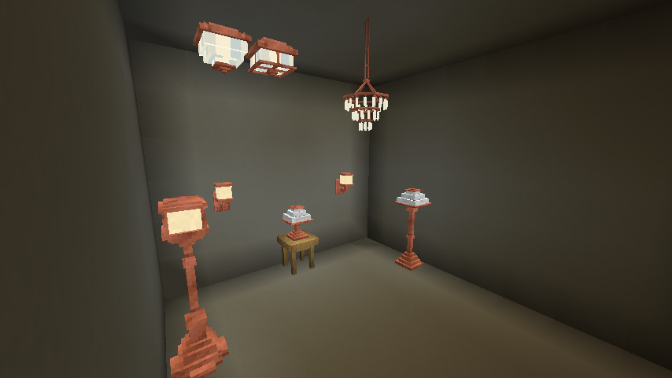
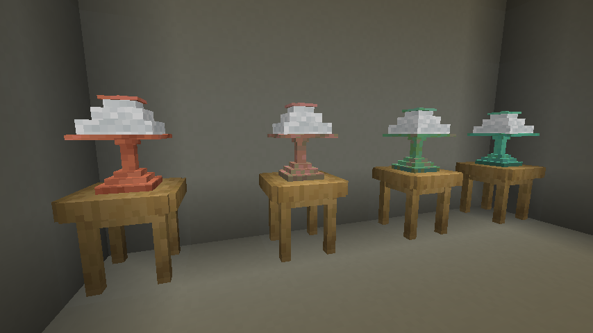

# Lighting and copper finishes

[Manual contents](README.md) · [Recipes](recipes.md) · [Catalog](catalog.md)

Copper lighting provides illumination as soon as it is placed. These lamps do not need fuel, redstone power, or an electrical network, and there is no use-to-toggle switch in their current block behavior. Their appearance can change with oxidation.

## Choose a light

| Light | Placement and reserved space |
| --- | --- |
| Wall sconce | Attach to a supported side face; one block space |
| Chandelier | Hang from a ceiling or a vertical copper/vanilla chain; one block space |
| Bowl ceiling light | Attach to the underside of a supporting ceiling; one block space |
| Coffered ceiling light | Ceiling-mounted alternative; one block space |
| Table lamp | Place on a supported top, including a side table or nightstand; one block space |
| Floor lamp | Place on top of a supported floor with three vertical spaces clear |
| Lamp post | Place on top of a supported floor with three vertical spaces clear |

Lights emit level **15**. For floor lamps and lamp posts, the upper section is the light-emitting part. Copper chains provide support and decoration but do not emit light. Use the recipe reference for the base forms and waxed variants.

For a hanging installation, build a ceiling support, place a vertical chain beneath it, and use the underside of the chain to attach a chandelier. Horizontal chains do not qualify as chandelier support. Removing support can remove the light, so build from the support downward.

<!-- screenshot:lighting-01:start -->

*Each light has a placement role; copper chains provide support rather than illumination.*
<!-- screenshot:lighting-01:end -->

## Oxidation and waxing

The copper families have four appearances: **copper → exposed → weathered → oxidized**. Unwaxed forms age through random ticks; there is no fixed real-time completion schedule. Waxed versions preserve a chosen stage.

Use honeycomb on a supported copper fitting to wax it. Use an axe to remove wax; on an unwaxed fitting, an axe scrapes oxidation back one stage. The mod supplies oxidation and waxing mappings for its copper content. Crafting recipes also provide waxed forms where listed. Check the [catalog](catalog.md) for whether a particular stage has a direct recipe or is reached through transformation.

Copper countertops and sinks participate in the same finish system. Changing the stage changes appearance, not a sink into an interactive fluid container. For multiblock lamps, inspect all three sections after a finish change during review; these fixtures use specialized weathering behavior to keep their sections consistent.

<!-- screenshot:lighting-02:start -->

*Waxing preserves each stage; unwaxed copper changes through oxidation.*
<!-- screenshot:lighting-02:end -->

## Plan a consistent room

Choose the desired stage, let unwaxed pieces age or obtain the stage in Creative, then wax them. Match chains and fixtures if you want the whole installation to keep one appearance. In a Survival walkthrough, do not substitute a Creative-obtained aged item without explaining the oxidation route.

## Troubleshooting

| Symptom | Check |
| --- | --- |
| Chandelier will not attach | Click underneath a supporting ceiling or vertical chain; horizontal chains do not support it. |
| Ceiling light will not place from above | It is mounted underneath a ceiling. |
| Lamp post or floor lamp will not place | Reserve three vertical spaces and a supported floor. |
| Copper changes color | It is unwaxed and oxidizing. Wax the stage you want to keep. |
| Aged lighting has no crafting recipe | Some stages are obtained through oxidation instead. |
| Light will not turn off when clicked | No manual or redstone switch is implemented for these light families. |

**In-game review complete:** the author confirmed waxing, scraping, and section synchronization checks on October 10, 2026. Timing depends on game ticks and surrounding conditions.
